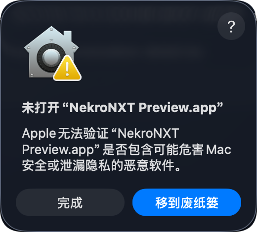
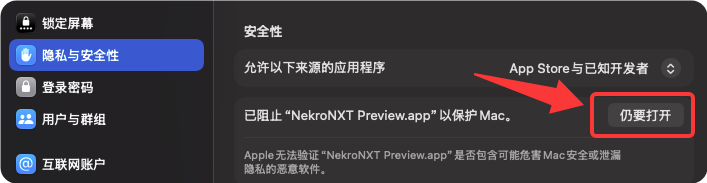
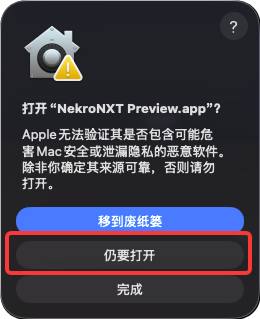

# 桌面版安装

NekroNXT 桌面版（Desktop）把界面与完整运行环境放进一个安装包，日常使用不要求预装 Node.js、pnpm、Python 或 Docker。

## 下载渠道

- **稳定版（Stable）**：从[最新正式版](https://github.com/NekroAI/nekro-nxt/releases/latest)下载，固定 Tag 和安装包不会被后续版本覆盖；
- **预览版（Preview）**：`main` 完整 CI 通过后更新的滚动构建，适合提前验证下一版改动。

发布流程会核对每个安装包的版本、Release ID、commit、文件大小和 SHA-256；GitHub 资产列表显示安装包的 SHA-256。

## 平台

### macOS

下载与芯片匹配的 DMG：Apple Silicon Mac 选择文件名含 `-mac-arm64-` 的包，Intel Mac 选择含 `-mac-x64-` 的包。打开 DMG，将 NekroNXT 拖入“应用程序”，然后从“应用程序”中启动。

macOS 安装包已经过完整性校验，但尚未使用 Apple Developer ID 签名和公证。首次打开时需要手动确认；下面的操作只适用于从 [NekroAI 官方 Release](https://github.com/NekroAI/nekro-nxt/releases)下载的安装包。截图使用 Preview，正式版中的应用名称是 `NekroNXT.app`。

#### 首次打开被系统拦截

1. 第一次启动时，如果看到“未打开 NekroNXT.app”或“未打开 NekroNXT Preview.app”，点击“完成”，不要点击“移到废纸篓”。

   

2. 打开“系统设置 → 隐私与安全性”，向下找到对应的 NekroNXT 拦截记录，点击右侧的“仍要打开”。这个按钮只有在上一步启动被拦截后才会出现。

   

3. macOS 再次询问时，确认应用名称是 `NekroNXT.app` 或 `NekroNXT Preview.app`，点击“仍要打开”。完成一次确认后，可直接启动当前安装的版本。

   

如果系统仍提示应用“已损坏”，或者“隐私与安全性”中始终没有“仍要打开”，请删除旧应用和旧 DMG，再从官方 Release 下载最新版本。

### Windows

下载 x64 `setup.exe`。安装向导允许选择当前用户安装目录，卸载默认保留产品数据。

### Linux

下载 x64 AppImage，赋予执行权限后运行：

```bash
chmod +x nekro-nxt-*.AppImage
./nekro-nxt-*.AppImage
```

## 稳定版与预览版

两条通道使用不同 appId、安装身份、快捷方式和数据目录，可以并装。Preview 图标右下角带黄铜—流明蓝—黄铜三节点标记；不要把两个通道的数据目录互相覆盖。

升级同一通道时安装新的安装包。应用展示名是 `NekroNXT`，现有 `NekroNxt` 数据目录和可执行文件标识沿用原名，升级后会找到原来的数据。

## 数据与远程实例

窗口可以保存多个远程服务端；每个实例拥有独立设备凭据和浏览器存储。切换实例只改变当前管理界面，其他实例中的智能体照常运行。

备份和恢复见[升级、备份与恢复](upgrade-backup.md)。

## 数据目录

本机实例的智能体、频道、凭据和本机偏好都保存在数据目录里。默认位置：

| 系统 | 正式版 | 预览版 |
| --- | --- | --- |
| Windows | `%APPDATA%\NekroNxt` | `%APPDATA%\NekroNxt Preview` |
| macOS | `~/Library/Application Support/NekroNxt` | `~/Library/Application Support/NekroNxt Preview` |
| Linux | `~/.config/NekroNxt` | `~/.config/NekroNxt Preview` |

### 更改数据目录

在「设置 → 存储」里点「更改」，选择一个空文件夹。NekroNXT 会先检查这个位置，然后显示迁移方式、大小和预计时间：

- 同一个磁盘内直接移动，通常几秒完成；
- 换到另一个磁盘时先复制并逐个校验，校验通过才切换，原目录保留。

确认后应用会重启，期间本机实例暂停，窗口显示迁移进度，完成后自动从新目录打开。

不能选择的位置：

- 不是空文件夹，或者和当前数据目录互相包含；
- 无法写入，或磁盘空间不足（复制时需要数据大小再多 10%）；
- 网络盘，以及 OneDrive、Dropbox、iCloud 云盘、坚果云、百度网盘的同步文件夹。数据库在同步过程中可能损坏；
- Windows 上路径太长，会让部分文件超过 260 个字符。

迁移后：

- 每个频道收到下一条消息时，智能体先整理之前的对话摘要，再开新的对话；
- 复制时不带走日志、扩展缓存和下载的运行环境，需要时会重新生成；运行代码前可能要重新下载运行环境；
- 升级恢复点留在原目录，不能用于新目录。下次升级会在新目录生成新的恢复点；
- 「设置 → 存储」显示「旧目录」的路径和大小。确认新目录正常后，可以点「在文件夹中显示」找到它并手动删除，再点「我已删除，不再提示」。

迁移失败（复制出错、校验不一致、文件被占用等）时，NekroNXT 删除这次在新目录创建的文件，回到原目录，并说明哪个文件因为什么失败。迁移中途断电或崩溃，下次打开时会先恢复原目录，然后可以重新迁移。

数据目录放在外置盘上时，打开 NekroNXT 前先连接这块盘；找不到数据目录时应用会提示并退出，不会新建一个空实例。

### 用环境变量指定（高级）

设置环境变量 `NEKRO_DESKTOP_USER_DATA` 为一个绝对路径后，NekroNXT 直接使用这个目录，「设置 → 存储」里的「更改」不可用。适合测试或多个隔离环境，不会迁移已有数据。

Docker 版的数据目录由挂载的卷决定，不提供这个功能。
